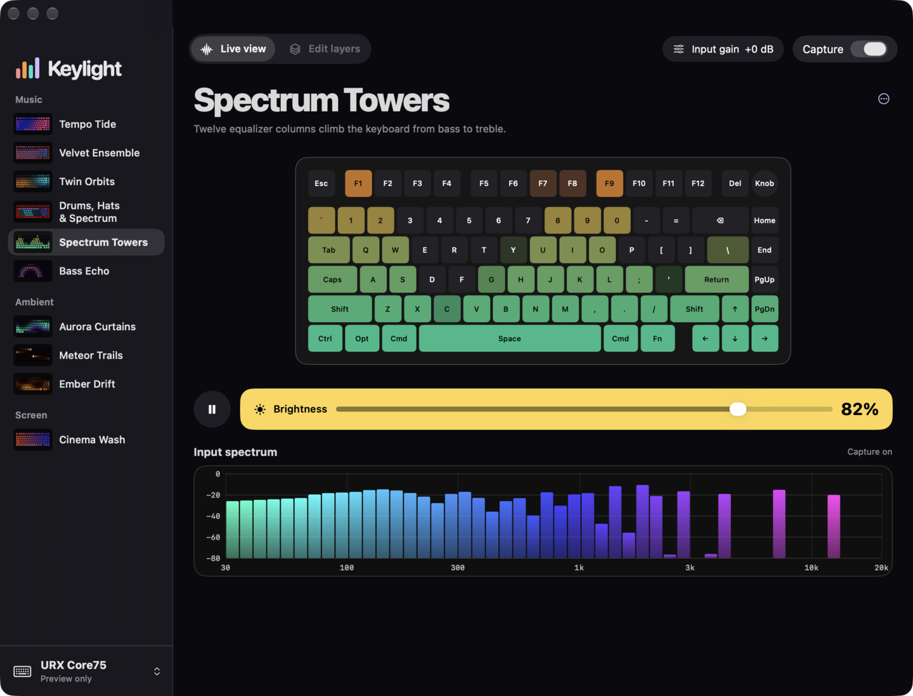

# Keylight

Keylight is a native macOS app that syncs the URX Core75 keyboard to your music or screen over USB or its 2.4 GHz receiver. It drives the keyboard directly and includes a live preview for designing effects.



*Spectrum Towers responding to a generated audio signal.*

## Build and run

Build with Xcode 26 or newer. The app runs on macOS 14 or later.

```sh
git clone https://github.com/KineticTactic/keylight.git
cd keylight
./scripts/build-app.sh
open dist/Keylight.app
```

Keylight tries to connect once at launch. To connect later, open **URX Core75 → Connect keyboard**. Pick one of ten modes and enable **Capture** for music or screen sync. macOS will ask for recording permission. Ambient modes run without capture.

To make your own mode, duplicate a preset and open **Edit layers**. You can assign effects to individual keys, tune frequency bands, and choose a color that fades in during silence. Your edits save automatically.

Run `swift test` to test the project. For more on effects, controls, and hardware support, see the [Keylight guide](docs/guide.md).
