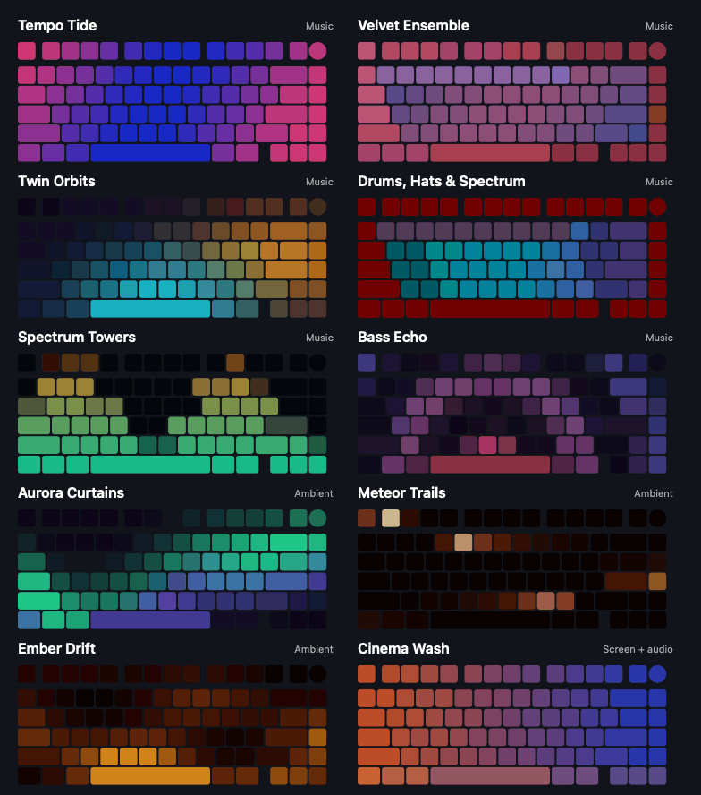

# Keylight guide

A native macOS lighting editor for the URX Core75 over a USB cable or its 2.4 GHz receiver. Requires macOS 14 or newer. The Swift package uses Apple frameworks and has no external runtime dependencies.



*Mode previews rendered with simulated playback and screen colors. The app uses your Mac’s live inputs.*

## Lighting modes

Choose a mode in the sidebar or menu bar. Each is ready to use, and **Edit layers** opens its colors, masks and response controls.

| Mode | Input | What you’ll see |
| --- | --- | --- |
| **Tempo Tide** | Music | A pink and blue wave travels across the keys over 2, 4, 8 or 16 beats. Its speed eases into the detected tempo. |
| **Velvet Ensemble** | Music | A coral rim, blue center, and lavender number row glide over a 16-beat cycle. Bass, mids, and treble brighten their corresponding regions and move a soft highlight through each one. |
| **Twin Orbits** | Music | Amber and cyan lights circle on different paths. Bass broadens the first light and treble stretches the second orbit. |
| **Drums, Hats & Spectrum** | Music | Red percussion around the edge, lavender hi-hats on the number row, and a three-color spectrum across the interior. |
| **Spectrum Towers** | Music | Twelve independent equalizer columns span 45 Hz to 16 kHz and rise from the bottom row. Aqua at the base gives way to amber at the peaks. |
| **Bass Echo** | Music | Each bass hit launches an independent coral-to-blue wave. Choose outward or inward rings, or a horizontal or vertical sweep, with **Wave direction** in **Live view**. |
| **Aurora Curtains** | Ambient | Mint and violet ribbons curl above and below one another. |
| **Meteor Trails** | Ambient | Comets travel in opposite directions on alternating rows, trailing amber light. |
| **Ember Drift** | Ambient | A slow copper-to-gold glow rises from the lower rows. |
| **Minecraft** | Screen + Fabric mod | Live screen colors with Elytra edge ripples, violet Nether portal transitions and a red damage flash. |
| **Cinema Wash** | Screen + audio | Display colors blend across five regions. Bass adds warmth along the bottom row. |

**Tempo Tide**, **Velvet Ensemble**, and **Twin Orbits** estimate 65–180 BPM from repeated attacks in playback audio. The tracker looks for repeated spacing between attacks across several beats. It weighs their strength and can follow a pulse through extra notes and skipped beats. **Detected hit** flashes on accepted attacks. The dot on **Metronome** crosses the top once per beat of the lighting clock, including while the detector is finding a tempo. **Holding** indicates a recent estimate carried through a short gap. Sparse or syncopated passages can take longer to lock, and subdivisions can produce a half- or double-time estimate. Motion continues smoothly while listening. Open **Edit layers → Appearance → Beats per cycle** to adjust the pace. In Velvet Ensemble and Twin Orbits, **Mix smoothing** sets how gradually the lights respond to bass, mids, and treble (0.4–3 seconds).

## Run on your Mac

Build locally with Xcode 26 or newer. The app uses native Liquid Glass on macOS 26 and later, with native materials on macOS 14 and 15.

```sh
./scripts/build-app.sh
open dist/Keylight.app
```

1. Select a lighting mode. Ambient modes start animating in the preview immediately.
2. Keylight tries to connect once at launch. If that attempt fails, it stays in preview until you open **URX Core75** at the foot of the library and click **Connect keyboard**. Use the connection picker for the USB cable or 2.4 GHz receiver.
3. Turn on **Capture** for music and cinema modes. Allow screen and system audio recording when macOS prompts. For Cinema Wash, choose the display to sample. Capture runs locally and excludes the editor window.

**Disconnect** or quit normally to restore the previous keyboard lighting. Quit competing lighting controllers before connecting. Keylight only sends volatile lighting updates.

## Match the keyboard colors

Open **Calibrate colors…** at the foot of the sidebar. The swatch shows the target color and the keyboard displays a solid test patch. Adjust the red, green and blue sliders while looking at the keys. For cyan-tinted switches, start with white and lower green and blue until the keys look neutral. Aim for the closest hue the LEDs and switches can produce.

Choose **Apply to all modes** at any point. Keylight interpolates between your matches for every other color, including dim keys and fades. The seven essentials cover white and the saturated colors. **Fine tuning** adds 19 individually adjustable shades. Black always turns the LEDs off. **Cancel** discards the current session. Switch **Calibrated colors** on or off at the foot of the sidebar to compare the result while a mode is playing. Keylight keeps your matches and remembers the switch setting when you reopen the app. Turning it on for the first time opens calibration setup. The USB cable and receiver share the same profile.

## Minecraft

Select **Screen → Minecraft**, turn on **Capture**, and select the display where you play. Screen sync uses Keylight’s usual macOS recording permission. For game events, install the client companion in the Fabric 26.3 instance you play and restart Minecraft. For the standard Mac launcher, build and install it with JDK 25 and Python 3 after launching the Fabric profile once:

```sh
./scripts/build-minecraft-mod.py
cp dist/keylight-damage-26.3.jar "$HOME/Library/Application Support/minecraft/mods/"
```

During Elytra flight, a bright green ripple runs down the leftmost keys and a cyan ripple runs down the rightmost keys. Their speed follows your flight speed. Each firework boost sends a brighter pulse down those same two columns. The center keys keep their live screen colors. In a Nether portal, violet moves from the rim toward the center as the portal charges. Stepping out reverses the effect. After crossing, the new display colors return from the center outward. A damage hit takes priority and flashes the board red for 300 ms.

The client sends game events to UDP port 49375 on IPv4 localhost. It works with the HUD hidden and on multiplayer servers. Screen sync also works on its own. Keylight listens during active Minecraft-mode capture and releases the port when you pause or switch modes.

## Existing libraries

The original **Drum perimeter** mode now appears as **Drums, Hats & Spectrum**, with its saved colors, thresholds and masks. An existing personal name takes precedence. Untouched **Northern lights** and **Screen + bass** starters are replaced by **Aurora Curtains** and **Cinema Wash**. Edited versions and duplicates are kept under **My modes**.

## Tune lighting to playback

Turn on **Capture** to see the 48-bar spectrum from 30 Hz to 20 kHz. The global **Input gain** control beside Capture adjusts the level used by the analyzer and every mode from −12 to +24 dB. Click **Reset** for unity gain. In **Edit layers**, select a layer and open **Audio** to tune its response. The shaded range follows the low and high cutoffs. The dashed line marks the threshold. You can drag the sliders or enter exact frequencies and thresholds.

For **Drum hit** and **Hi-hat**, the threshold measures the rise in the selected range on an attack. Other effects use the energy in the range. Raise **Layer gain** to brighten the response. For **Spectrum Towers**, choose **Edit layers → Equalizer bars → Audio → Tower band** to edit any column. Existing four-zone tower settings expand into three narrower bands per zone, carrying over gain and threshold. For **Frequency bands**, choose a keyboard zone to set its own frequency limits, threshold and gain. On visual layers, turn on **Modulate layer brightness with audio** to drive the existing color or animation from a frequency range. Settings are saved per layer and effect in the scene library.

Enable **Silence color** under **Edit layers → Audio** to choose a resting color for that layer’s keys. With Capture on, 1.5 seconds of quiet starts a 1.8-second fade. When playback returns, the resting color mostly clears within 0.1 seconds. This uses overall playback after input gain, independently of the layer’s frequency filter.

**Velvet Ensemble** tracks short accents against the recent level in each frequency region. Adjust **Reactivity** in Live view to change how strongly the three regions move.

## Make an effect

Open the menu beside the mode title to duplicate or rename a mode. Choose **Edit layers**, add a layer and select its effect. The keyboard preview stays in view as you scroll the controls. Open **Keys** and click keys in that preview to create a mask. **Select keys → All keys** clears the mask. The frontmost layer appears at the top of the stack. Use the up and down arrows to change the selected layer’s position. For example, put a wave under a bass pulse, select the pulse layer, and click Space. Scenes save automatically in `~/Library/Application Support/Keylight/Scenes.json`.

To add a procedural effect in Swift, add an `Effect` case in `Sources/Keylight/Lighting/Scene.swift` and implement its color calculation in `EffectEngine.render`. The effect picker and Add Layer menu enumerate the available cases. Add effect-specific editor controls in `Sources/Keylight/Views/LayerInspector.swift`.

## Hardware

Plug the Core75 receiver into the Mac, switch the keyboard to 2.4 GHz mode and wake it with a keypress. Open **URX Core75** and choose **2.4 GHz receiver** and click **Connect keyboard**. **Automatic** tries the USB cable first, then the receiver. Disconnect before changing modes.

The driver matches the vendor lighting collection (usage ff60:0061) on the cable (36b0:3130) and receiver (36b0:3002). Cable mode probes the URX streaming extension and falls back to VIA. Receiver mode uses VIA and waits for each radio acknowledgement. Full-board animations can update more slowly over the radio. Brightness-only updates use fewer packets. VIA exposes 81 addressable keys and reserves the knob LED. The preview includes the knob so it can also represent the 82-LED streaming layout. VIA snapshots the volatile per-key colors, global brightness and effect and restores them on normal disconnect. An unplug or power loss can interrupt restoration.

The layout and protocol references are the [URX firmware](https://github.com/URX-keyboard/qmk_firmware/tree/core75/keyboards/urx/core75), [URX plugin](https://wiki.urx.co.in/core75/software_firmware_downloads/) and [ColorHoster protocol implementation](https://github.com/Azarattum/ColorHoster).

## Verification

```sh
swift test
dist/Keylight.app/Contents/MacOS/Keylight --devices
dist/Keylight.app/Contents/MacOS/Keylight --probe
```

Append `--wireless` or `--wired` to any diagnostic command to target that connection. The probe queries lighting capabilities without selecting a mode. To run the visible keyboard test, close competing lighting apps and run:

```sh
dist/Keylight.app/Contents/MacOS/Keylight --test-keys
```

It plays a wave for 90 frames, then displays red Esc, green Space and a blue Right Arrow. On VIA it reads the per-key values back from the board and verifies restoration of the previous state. The fps number measures host delivery.
